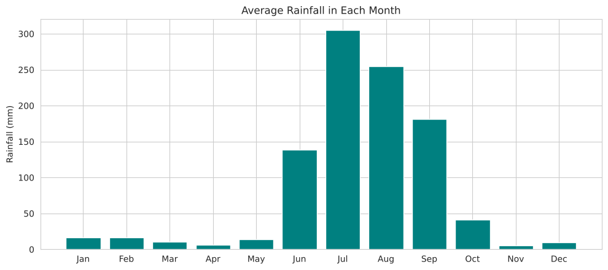
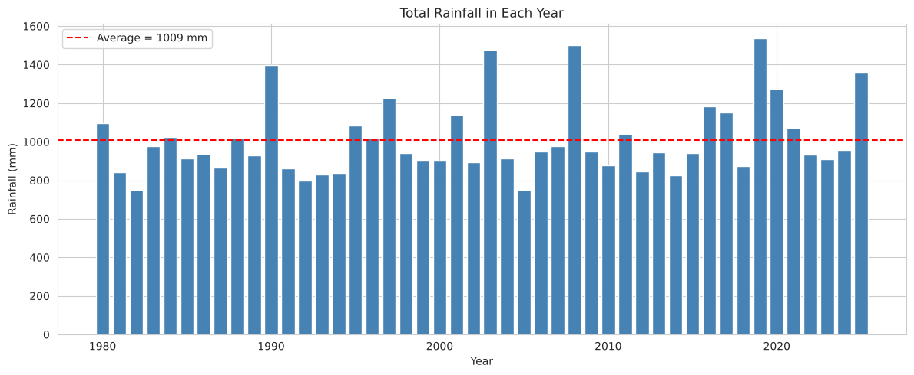
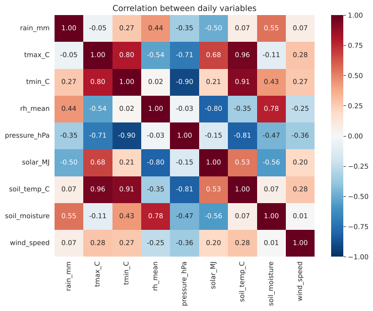
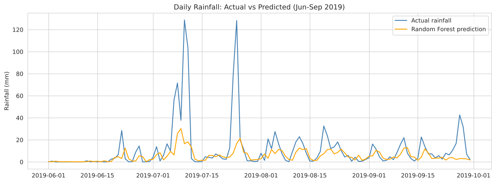
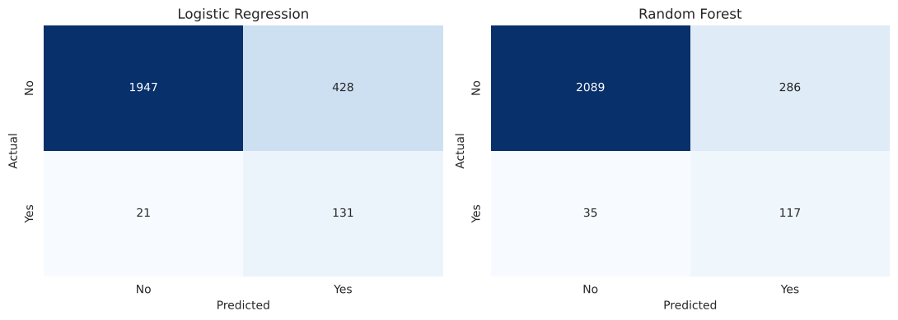
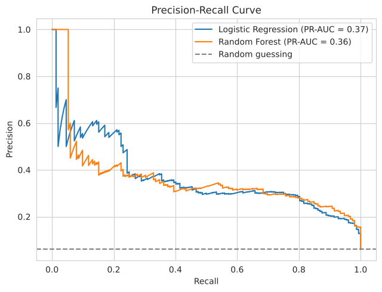
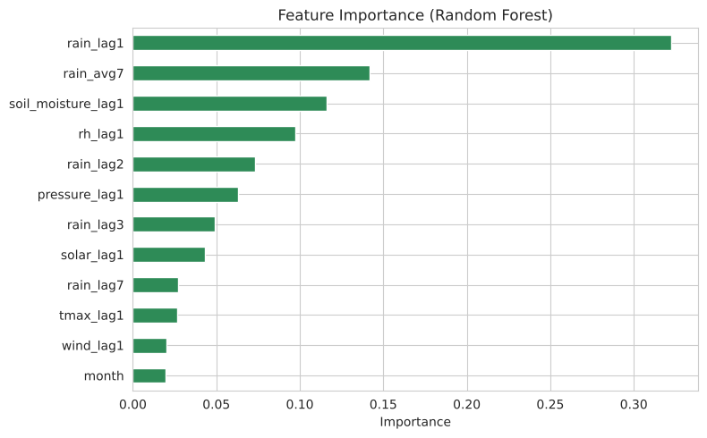

# Rainfall Prediction Using ERA5-Land Weather Data


A machine learning project that analyses historical rainfall patterns and predicts daily rainfall using historical weather variables from the **ERA5-Land reanalysis dataset**.

<p align="center">
  
</p>

## Project Overview

This project uses approximately 46 years of hourly ERA5-Land data for a single grid point near **Varanasi, India (25.3°N, 83.0°E)**. Six weather datasets are cleaned, merged, converted into daily observations and used for exploratory analysis and machine learning.

The project has three objectives:

1. **Exploratory Data Analysis (EDA):** understand annual and seasonal rainfall patterns, rainfall intensity distribution and relationships between rainfall and weather variables.
2. **Rainfall Amount Prediction (Regression):** estimate daily rainfall in millimetres using historical weather observations.
3. **Moderate-or-Higher Rainfall Classification:** predict whether daily rainfall will be at least **15.6 mm**.

> **Important terminology:** 15.6 mm is the IMD threshold for *moderate rainfall*, not the threshold for *heavy rainfall*. Therefore, the classification target in this notebook means **moderate-or-higher rainfall**. The IMD heavy-rainfall threshold begins at 64.5 mm in a 24-hour reporting period.

## Key Results

### Regression — rainfall amount

The target is transformed using `log1p(rain_mm)` to reduce the effect of the highly skewed rainfall distribution. The reported R² is therefore on the log-transformed target scale.

| Model | R² (log scale) | MAE (log scale) | MAE (mm) |
|---|---:|---:|---:|
| Baseline (training average) | -0.004 | 0.802 | 3.38 |
| Linear Regression | 0.586 | 0.430 | 2.76 |
| **Random Forest Regressor** | **0.656** | **0.362** | **2.33** |

Random Forest performed best among the regression models evaluated. The MAE in millimetres is calculated after converting predictions back from the log scale. The model captures broad wet/dry patterns but has difficulty reproducing the largest rainfall peaks.

### Classification — moderate-or-higher rainfall

The positive class is defined as `rain_mm >= 15.6`. The classification dataset is imbalanced, so precision, recall, F1-score and PR-AUC are more informative than accuracy alone.

| Model | Precision | Recall | F1-score | ROC-AUC | PR-AUC |
|---|---:|---:|---:|---:|---:|
| Logistic Regression | 0.234 | **0.862** | 0.368 | 0.912 | **0.369** |
| Random Forest Classifier | **0.290** | 0.770 | **0.422** | **0.917** | 0.365 |

- Logistic Regression has higher recall, so it identifies a larger share of actual moderate-or-higher rainfall days, at the cost of more false alarms.
- Random Forest has higher precision and F1-score in the saved notebook results.
- The test-set positive-class prevalence is approximately 6%; the PR-AUC baseline is therefore approximately 0.06.

These results are from the notebook's saved execution outputs. Re-run the notebook in your environment to reproduce them.

## Dataset Description

The input consists of six hourly CSV files. All are joined using the common `valid_time` timestamp.

| Dataset | ERA5-Land variable(s) | Description | Raw unit |
|---|---|---|---|
| 2 m temperature | `t2m`, `d2m` | 2 m air temperature and 2 m dew-point temperature | K |
| Surface pressure and precipitation | `sp`, `tp` | Surface pressure and total precipitation | Pa, m |
| Surface radiation | `ssrd` | Surface solar radiation downwards | J/m² |
| Soil temperature | `stl1` | Soil temperature in the top soil layer | K |
| Soil water | `swvl1` | Volumetric soil water in the top soil layer | m³/m³ |
| 10 m wind | `u10`, `v10` | Eastward and northward wind components | m/s |

**Coverage:** 1 January 1980 to 1 December 2025  
**Hourly observations:** 402,528 per input file  
**Daily observations after aggregation:** 16,772  
**Location:** one ERA5-Land grid point at 25.3°N, 83.0°E

The 2025 data ends on 1 December and is not a complete calendar year.

### Data access and file size

The six original CSVs are large (roughly 25–31 MB each). They are not included in this README package. Download the corresponding ERA5-Land data from the [Copernicus Climate Data Store](https://cds.climate.copernicus.eu/) or add your own data files to a local `data/` directory.

If you publish the CSVs in this repository, check GitHub's file-size limits. GitHub blocks regular Git files larger than 100 MB; Git LFS may be appropriate for large files. Do not commit credentials or API keys.

## Methodology

### 1. Data loading and merging

- Read the six CSV files with pandas.
- Remove latitude and longitude columns because the notebook uses a single grid point.
- Rename raw variable codes to readable names.
- Merge the six tables on `valid_time`.
- Check missing values and timestamp consistency.

### 2. Unit conversion and derived variables

| Variable | Transformation | Resulting unit |
|---|---|---|
| Air and dew-point temperature | Kelvin − 273.15 | °C |
| Soil temperature | Kelvin − 273.15 | °C |
| Surface pressure | Pa ÷ 100 | hPa |
| Total precipitation | metres × 1000 | mm |
| Solar radiation | J/m² ÷ 1,000,000 | MJ/m² |
| Wind speed | `sqrt(u10² + v10²)` | m/s |
| Relative humidity | Estimated from air temperature and dew point using the Magnus formula | % |

Small negative precipitation values caused by numerical precision are clipped to zero.

### 3. Hourly-to-daily aggregation

The notebook creates one row per calendar day:

- Temperature: daily maximum, minimum and mean.
- Rainfall: daily sum.
- Solar radiation: daily sum.
- Relative humidity, pressure, wind speed, soil temperature and soil moisture: daily mean.

**Reporting-window limitation:** this uses midnight-to-midnight calendar-day aggregation. It is not aligned to the IMD 08:30 IST 24-hour rainfall observation window. The IMD thresholds are used as amount categories, but direct operational comparison with IMD daily reports requires aligning the aggregation window and time zone.

### 4. Exploratory Data Analysis

The notebook investigates:

- Total annual rainfall and wettest/driest years.
- Average rainfall by month and monsoon seasonality.
- Distribution of rainfall across IMD intensity categories.
- Correlation between rainfall and weather variables.

#### Annual rainfall



The saved notebook output identifies 2019 as the wettest year (approximately 1,536 mm) and 2005 as the driest year (approximately 749 mm). The 2025 record is incomplete.

#### Monthly rainfall seasonality


The notebook reports that approximately 88% of rainfall occurs during June–September.

#### Rainfall and weather-variable correlation



The strongest positive correlations in the notebook are with soil moisture (0.55) and relative humidity (0.44). Solar radiation (-0.50) and surface pressure (-0.35) have negative correlations. Correlation does not imply causation.

### 5. Regression modelling

The regression task estimates daily rainfall amount.

**Target transformation:**

```python
y = np.log1p(rain_mm)
```

Predictions are converted back to millimetres using `np.expm1()`.

**Features:** lagged rainfall, a previous-seven-day rainfall average, lagged weather variables and month. The notebook uses past-day information rather than same-day weather values.

**Train/test split:**

- Training: 8 January 1980 – 31 December 2018
- Testing: 1 January 2019 – 1 December 2025

The split is chronological rather than random to simulate prediction on a later time period.

Models compared:

- Baseline predictor using the training target average.
- Linear Regression.
- Random Forest Regressor.

#### Actual vs predicted rainfall



The plot compares actual and Random Forest predicted rainfall for June–September 2019. The model follows some wet/dry variation but smooths or underestimates the highest peaks.

### 6. Classification modelling

The classification target is:

```python
strong_rain = (rain_mm >= 15.6).astype(int)
```

Here, `1` means **moderate-or-higher rainfall (≥15.6 mm)** and `0` means rainfall below 15.6 mm.

The positive class is rare:

- Training: 672 positive days out of 14,238 (approximately 4.7%).
- Testing: 152 positive days out of 2,527 (approximately 6.0%).

Models:

- Logistic Regression with standardised features.
- Random Forest Classifier.
- `class_weight="balanced"` to account for class imbalance.

Evaluation uses precision, recall, F1-score, ROC-AUC and PR-AUC. Accuracy alone can be misleading when positive events are rare.

#### Confusion matrices



#### Precision-recall curve



#### Random Forest feature importance



In the saved notebook output, the most important classification features are previous-day rainfall (`rain_lag1`), the previous-seven-day rainfall average (`rain_avg7`), previous-day soil moisture and previous-day relative humidity.

## Project Structure

The following structure is recommended for GitHub:

```text
rainfall-prediction/
│
├── README.md
├── Rainfall_Pred_Simplified.ipynb
│
├── IMAGES/
│   ├── actual_vs_predicted_rainfall.png
│   ├── annual_rainfall.png
│   ├── monthly_rainfall_seasonality.png
│   ├── rainfall_correlation_heatmap.png
│   ├── classification_confusion_matrices.png
│   ├── precision_recall_curve.png
│   └── random_forest_feature_importance.png
│
├── data/
│   ├── temperature.csv
│   ├── pressure_precipitation.csv
│   ├── radiation.csv
│   ├── soil_temperature.csv
│   ├── soil_water.csv
│   └── wind.csv
│
└── requirements.txt
```

The `data/` folder is a suggested location for your six input files. The notebook currently reads CSV files from its working directory using their expected filenames. Either keep the six files beside the notebook with the expected names or update the file paths in the loading cell to point to `data/`.

## Installation and Usage

### 1. Clone the repository

```bash
git clone https://github.com/<your-username>/<your-repository-name>.git
cd <your-repository-name>
```

### 2. Create and activate a virtual environment (recommended)

```bash
python -m venv .venv
```

Windows:

```bash
.venv\Scripts\activate
```

macOS/Linux:

```bash
source .venv/bin/activate
```

### 3. Install dependencies

Create a `requirements.txt` containing:

```text
pandas
numpy
matplotlib
seaborn
scikit-learn
jupyter
ipykernel
```

Then run:

```bash
pip install -r requirements.txt
```

### 4. Add the six ERA5-Land CSV files

Place all six CSV files in the notebook's working directory, using the filenames expected in the notebook, or edit the loading paths to match your local `data/` directory.

### 5. Run the notebook

```bash
jupyter notebook
```

Open `Rainfall_Pred_Simplified.ipynb` and run all cells from top to bottom.

## IMD Rainfall Categories Used for EDA

The notebook groups daily rainfall amounts using the following thresholds:

| Category | Rainfall amount |
|---|---:|
| No rain | < 0.1 mm |
| Very light | 0.1–2.4 mm |
| Light | 2.5–15.5 mm |
| Moderate | 15.6–64.4 mm |
| Heavy | 64.5–115.5 mm |
| Very heavy | 115.6–204.4 mm |
| Extremely heavy | ≥ 204.5 mm |

The notebook's observed distribution is:

| Category | Days | Share |
|---|---:|---:|
| No rain | 9,828 | 58.60% |
| Very light | 3,292 | 19.63% |
| Light | 2,828 | 16.86% |
| Moderate | 791 | 4.72% |
| Heavy | 28 | 0.17% |
| Very heavy | 5 | 0.03% |
| Extremely heavy | 0 | 0.00% |

These thresholds are amount categories. For official comparison with IMD observations, use the same 24-hour reporting period ending at 08:30 IST.

## Limitations

- **Single location:** the analysis represents one ERA5-Land grid point, not all of Varanasi or a wider region.
- **Reanalysis data:** ERA5-Land is a model-based reanalysis product, not a direct rain-gauge observation at the selected point.
- **Daily aggregation:** the current calendar-day window differs from the IMD 08:30 IST rainfall reporting period.
- **Rare events:** heavy and very-heavy rainfall days are very limited in the available record. The current classifier uses the lower 15.6 mm threshold and should not be described as a heavy-rainfall warning model.
- **Forecasting scope:** this is a historical machine-learning experiment using lagged local variables. It is not a real-time operational weather forecast.
- **Validation:** the notebook uses one chronological holdout period. Additional rolling-origin validation and independent station observations would strengthen the evaluation.
- **Extreme rainfall:** regression models tend to smooth extreme peaks, and performance on rare high-rainfall days needs separate assessment.

## Future Improvements

- Align daily rainfall aggregation with the IMD 08:30 IST reporting window.
- Add rolling-origin time-series cross-validation.
- Evaluate a separate heavy-rainfall target (≥64.5 mm) while accounting for the small number of positive examples.
- Tune model hyperparameters using training/validation data only.
- Explore XGBoost or other gradient-boosting models.
- Add cyclical month features and longer rolling rainfall statistics.
- Compare against rain-gauge observations and extend the analysis to multiple locations.
- Evaluate performance specifically on heavy and very-heavy rainfall events.

## Technologies Used

- **Python**
- **Pandas** and **NumPy** — data cleaning, transformation and feature engineering
- **Matplotlib** and **Seaborn** — visualisation and exploratory analysis
- **Scikit-learn** — regression, classification, preprocessing and evaluation
- **Jupyter Notebook** — implementation and documentation
- **ERA5-Land** — hourly meteorological reanalysis data

## Data Source and Acknowledgement

The meteorological inputs are from **ERA5-Land**, distributed through the [Copernicus Climate Data Store (CDS)](https://cds.climate.copernicus.eu/).

Please consult the [Copernicus Climate Change Service (C3S) terms and licence information](https://cds.climate.copernicus.eu/) and cite the dataset appropriately when redistributing data or derived products.

## Author

**Your Name**

- GitHub: [@your-github-username](https://github.com/your-github-username)
- Project: Rainfall Prediction Using ERA5-Land Weather Data

---

*This repository documents an academic machine-learning project. Model outputs are experimental and should not be used as official weather warnings or for safety-critical decisions.*
